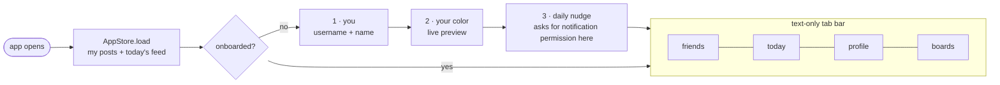
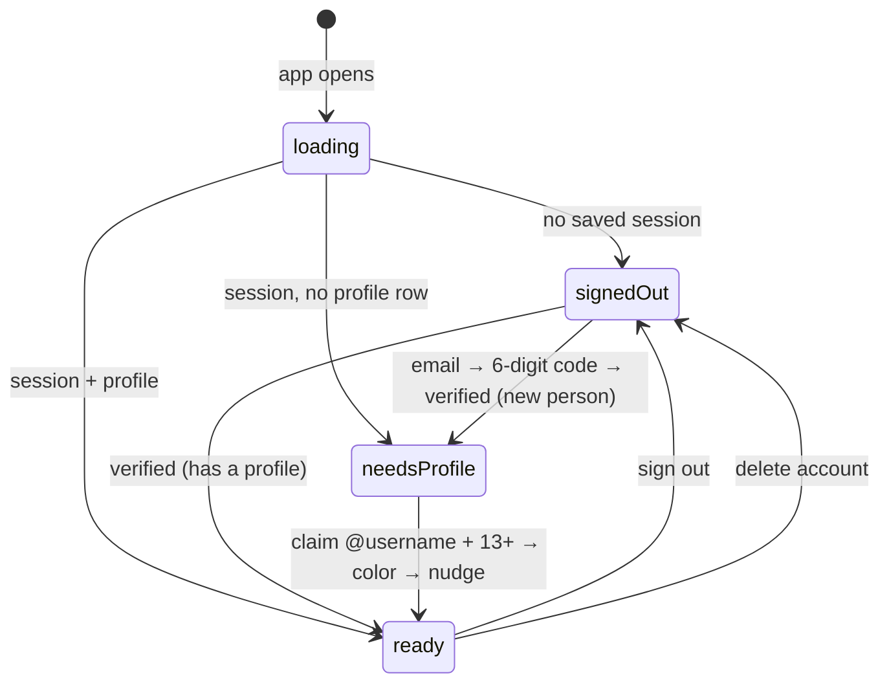
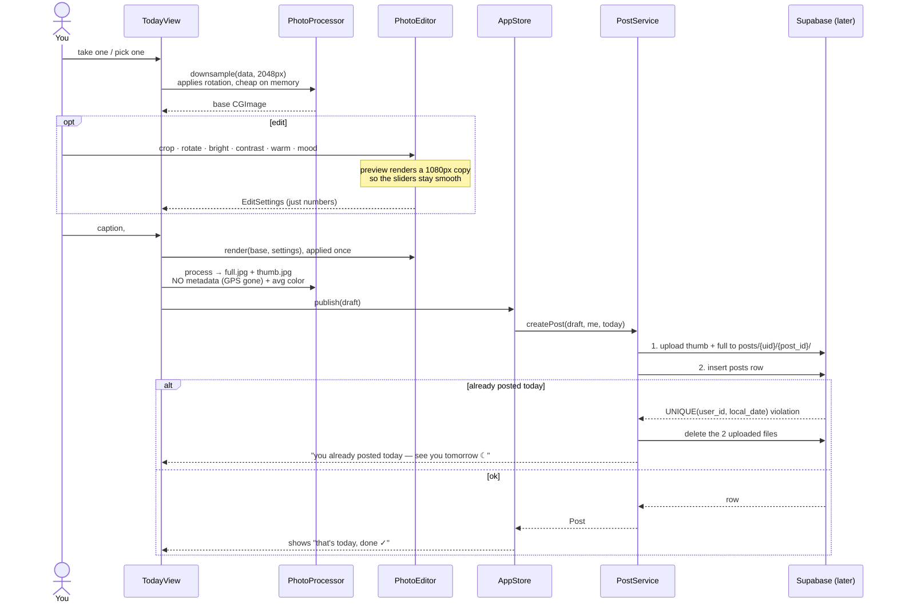
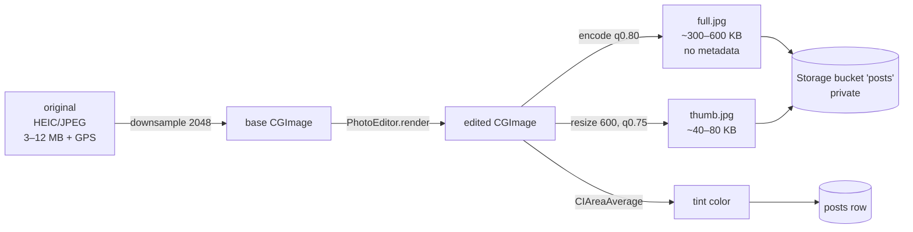
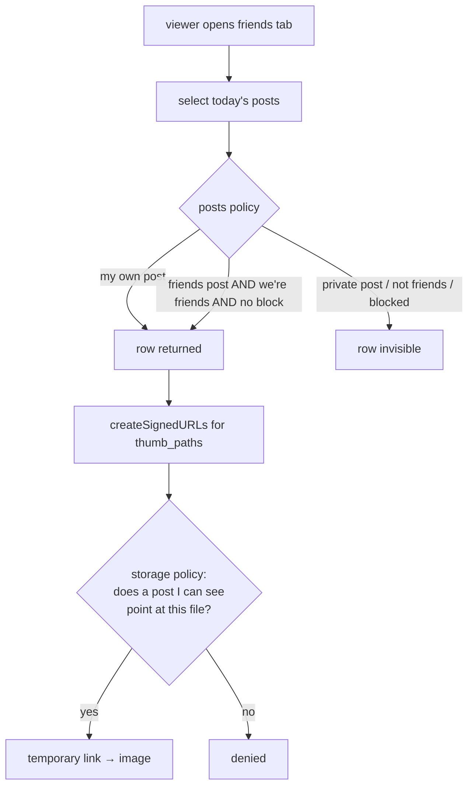
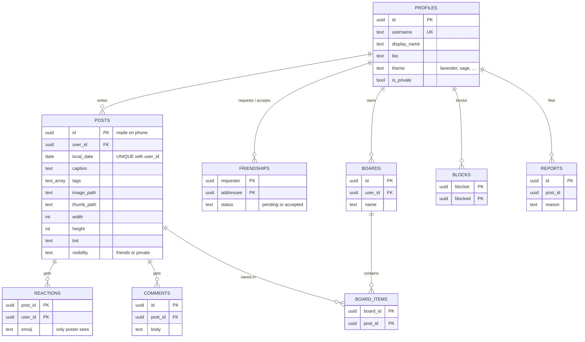
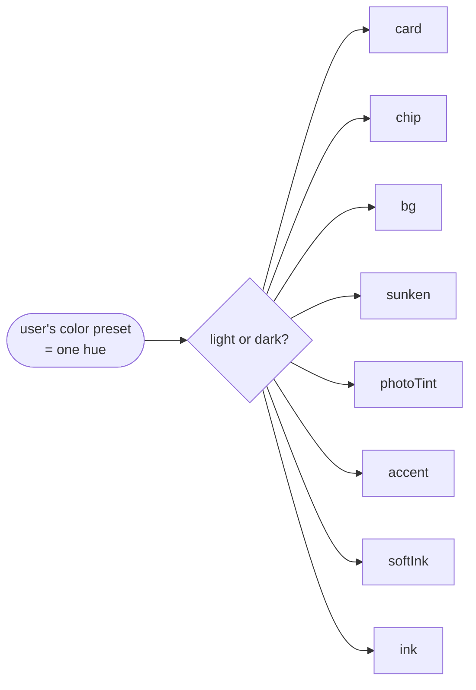
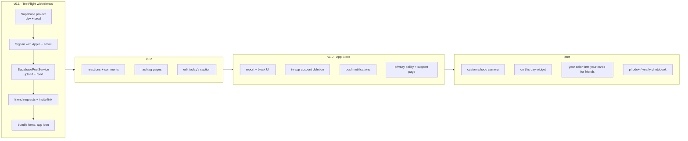

# phodo: how it all works

> one pic a day. just for your people.

This is the map of the app: what each piece does, how a post moves from your camera roll to your friends' feeds, and what's built versus planned. The graphs are [Mermaid](https://mermaid.js.org) diagrams. They render on GitHub and in Xcode-adjacent editors like VS Code (with the Mermaid preview extension).

---

## 1. Status at a glance

| Area | Status |
|---|---|
| Xcode project (XcodeGen), iOS 17+, SwiftUI | ✅ builds |
| Design system: color presets, brightness ramp, dark mode, components | ✅ |
| Onboarding: you → your color → daily nudge | ✅ |
| Today: pick or take a photo, edit, caption, tags, friends/just me, one post a day | ✅ (backend is in-memory) |
| Photo pipeline: downsample, strip GPS, full + thumb JPEGs, average color | ✅ unit-tested |
| Friends feed (masonry, "that's everyone"), save to board | ✅ sample data |
| Profile: pics / journal calendar, edit profile, settings | ✅ |
| Boards | ✅ in memory |
| Daily reminder (local notification) | ✅ |
| Accounts: email code sign-in, claim @username, 13+ gate, sign out, delete account | ✅ (demo mode until keys are added) |
| `SupabaseAccountService` + `SupabasePostService` (real upload, feed, signed links) | ✅ written, needs your project keys to run |
| Supabase schema + privacy rules (`0001`, `0002`) | 📝 written, not applied yet |
| Sign in with Apple | ⏳ after email sign-in works |
| Boards in Supabase | ⏳ still local-only |
| Friend requests UI, reactions, comments, report/block UI | ⏳ |
| Bundled fonts (Bricolage Grotesque, DM Mono) | ⏳ falls back to system fonts |

---

## 2. Project layout

```
phodo/
├── project.yml                  ← Xcode project definition (run `xcodegen generate`)
├── phodo/
│   ├── App/
│   │   ├── PhodoApp.swift       ← entry point, theme injection, tab bar
│   │   └── AppStore.swift       ← app-wide state + actions
│   ├── Design/
│   │   ├── Theme.swift          ← color presets, brightness ramp, fonts, metrics
│   │   └── Components.swift     ← header, chips, pill toggle, photo tile, masonry
│   ├── Models/
│   │   ├── Models.swift         ← LocalDay, Person, Post, Board, PostDraft
│   │   └── SampleData.swift     ← fake friends/posts until the backend exists
│   ├── Services/
│   │   ├── PostService.swift    ← backend protocol + in-memory mock
│   │   ├── PhotoProcessor.swift ← shrink, strip metadata, JPEG, average color
│   │   └── PhotoEditor.swift    ← crop / rotate / bright / contrast / warm / moods
│   └── Features/
│       ├── Onboarding/          ← 3-step setup, color picker, reminder picker
│       ├── Today/               ← composer, camera, photo editor
│       ├── Friends/             ← feed, post card, save-to-board sheet
│       ├── Profile/             ← profile, journal calendar, edit, settings
│       └── Boards/              ← saved collections
├── phodoTests/                  ← unit tests (photo pipeline, theme, one-a-day)
├── supabase/migrations/         ← database schema + privacy rules
└── docs/ARCHITECTURE.md         ← you are here
```

---

## 3. App architecture

Screens never talk to the backend directly. They read state from `AppStore` and call its methods. `AppStore` talks to a `PostService`. Today that service is `MockPostService`, which keeps everything in memory. Later, `SupabasePostService` swaps in without changing any screen.

```mermaid
flowchart TB
    subgraph UI["SwiftUI screens"]
        OB[OnboardingView]
        T[TodayView]
        F[FriendsFeedView]
        P[ProfileView]
        B[BoardsView]
        E[PhotoEditView]
    end

    subgraph Core
        S[(AppStore<br/>@Observable)]
        TH[Theme<br/>from color preset + light/dark]
    end

    subgraph Services
        PS{{PostService protocol}}
        M[MockPostService<br/>in memory, today]
        SB[SupabasePostService<br/>next]
        PP[PhotoProcessor]
        PE[PhotoEditor]
        UN[UNUserNotificationCenter<br/>daily nudge]
    end

    UI -- reads state / calls actions --> S
    TH -. environment .-> UI
    S --> PS
    PS --> M
    PS -.-> SB
    T --> PE --> PP
    E --> PE
    S --> UN
```

---

## 4. App launch and navigation



Every onboarding step can be skipped. The app asks for notification permission at step 3, right after the user says yes to a reminder, because people are much more likely to allow it then.

---

## 4b. Accounts



| Piece | How |
|---|---|
| Sign in | `signInWithOTP(email)` emails a code; `verifyOTP` turns it into a session, saved in the Keychain. The same screen handles sign-up and sign-in. |
| @username | Lowercase letters, numbers, `_` and `.`, 2–24 characters. Checked live as you type; the database's `UNIQUE` rule decides if two people race for the same name. |
| 13+ | A birthday picker on the phone. Only `is_13_plus = true` is stored, and the database refuses a profile without it. |
| Delete account | The app removes your photos from storage, then calls `delete_my_account()`, which deletes your login. Profile, posts, friends and boards are deleted along with it. |
| Demo mode | With no keys in `Config/Secrets.xcconfig`, `MockAccountService` takes over: any code works, and `maya`/`leo`/… count as taken. |

## 5. Posting: the full flow



### Why each step exists

| Step | Why |
|---|---|
| Downsample on load | iPhone photos are 12–48 MP. Decoding them at full size wastes 50–200 MB of memory. |
| Edits saved as settings | Sliders stay fast, "reset" is free, and the photo is processed only once. |
| Re-encode a fresh JPEG | Drops **all EXIF, including GPS**, so a post never leaks where you live. |
| full (2048) + thumb (600) | The feed loads small thumbs. The full image loads only when someone opens a post. |
| Width, height, average color | The masonry grid can lay out and tint placeholders *before* images arrive. |
| Post ID made on the phone | Upload paths are known before the database row exists. |
| `local_date` | "Today" means *your* today. 11pm in Texas still counts. |

---

## 6. Photo pipeline (sizes)



---

## 7. Viewing photos: privacy

The `posts` bucket is **private**. Nobody gets a permanent link. The app asks for **signed URLs** (temporary links that expire after about an hour), and Supabase only grants one if the database says you're allowed to see that post.



The trick: the storage rule checks the `posts` table, and that check runs under the `posts` table's own privacy rules. **If you can see the post, you can see its photo, and otherwise you can't.** The privacy logic is written once, in `supabase/migrations/0001_init.sql`.

Cache images by **storage path**, not URL, because signed URLs change every time you request them.

---

## 8. Data model



### Who can see what

| Thing | You | Friends | Everyone else |
|---|---|---|---|
| Your "friends" post + photo | ✅ | ✅ (unless blocked) | ❌ |
| Your "just me" post + photo | ✅ | ❌ | ❌ |
| Reactions on your post | ✅ | only their own | ❌ |
| Comments on your post | ✅ | ✅ | ❌ |
| Your boards | ✅ | ❌ | ❌ |
| Your username / name / bio | ✅ | ✅ | ✅ (so friends can find you) |

---

## 9. Design system

One hue per theme, with fixed brightness steps. This is Samuel's feedback: keep the single-color look, but use different brightness levels so elements stay distinct.



| Token | Light (s, b) | Lavender hex | Used for |
|---|---|---|---|
| `card` | 0.05, 0.99 | ≈ `#F3F0FD` | sheets, preview cards |
| `chip` | 0.09, 0.98 | ≈ `#E8E3FA` | unselected chips, toggle track |
| `bg` | 0.13, 0.96 | `#DCD5F5` | page background |
| `sunken` | 0.175, 0.94 | ≈ `#CFC6F0` | photo drop zone, empty calendar days |
| `photoTint` | 0.21, 0.92 | `#C4BAEA` | photo placeholders |
| `accent` | 0.35, 0.77 | ≈ `#8C80C4` | today ring on the calendar |
| `softInk` | 0.28, 0.38 | `#4A4560` | secondary text |
| `ink` | 0.33, 0.15 | `#1C1A27` | text, 1px lines, primary buttons |

Presets: **lavender** (default), sage, peach, sky, butter, rose. Adding one is a single line in `ThemePreset.all`.

Rules from "the vibe": 1px ink lines · 18–22px corners · 22px margins · lowercase everything · no likes, no follower counts.

### Fonts
The code uses Bricolage Grotesque and DM Mono when they're bundled, and system fonts otherwise. To bundle them:
1. Download both from Google Fonts (both are under the OFL license, free to ship in an app).
2. Put `BricolageGrotesque.ttf` and `DMMono-Regular.ttf` in `phodo/Resources/Fonts/`.
3. Run `xcodegen generate`. They're already listed under `UIAppFonts` in `project.yml`.
4. Check the PostScript names match the ones in `Theme.swift` (`PhFont`).

---

## 10. Running it

```bash
brew install xcodegen      # once
xcodegen generate          # after adding/removing files or editing project.yml
open phodo.xcodeproj       # ⌘R to run, ⌘U to test
```

The `.xcodeproj` is generated, so it's git-ignored. **Edit `project.yml`, not the project.**

Tests (`phodoTests/`):
- the photo pipeline shrinks to 2048/600 and **strips GPS**
- the editor crops to square and rotates
- the lavender theme matches the mockup's `#DCD5F5`
- one post per day; empty posts are rejected

---

## 11. Next steps (roadmap)



### Hooking up Supabase
The code is done. These steps connect it to your project:

1. **Keys:** copy `Config/Secrets.example.xcconfig` to `Config/Secrets.xcconfig` and fill in the host (no `https://`) and the publishable/anon key. The file is git-ignored. Then run `xcodegen generate`.
2. **Database:** run the migrations with the CLI (installed in the project through npm):
   ```bash
   npx supabase login
   npx supabase link --project-ref <your-project-ref>   # asks for your database password
   npx supabase db push
   ```
   Or paste `0001_init.sql`, then `0002_accounts.sql`, into Supabase → SQL Editor → Run.
3. **Email codes:** Supabase → Authentication → Emails → Templates. In **both** "Confirm signup" and "Magic Link", add `{{ .Token }}` so the email shows the code, for example `<p>your phodo code: <b>{{ .Token }}</b></p>`.
4. **Before real users:** set up custom SMTP (Resend or Postmark). Supabase's built-in email only sends a few per hour.
5. Later, make a second project, `phodo-prod`, and keep `phodo-dev` for testing.

### Before the App Store
- Report post, block user, and a filter for objectionable content (guideline 1.2), plus published contact info.
- In-app account deletion (5.1.1(v)).
- Privacy policy URL, privacy labels, privacy manifest.
- 13+ age gate at sign-up.
- Join the App Store Small Business Program (15% fee instead of 30%).

### Things to decide
- **Bundle ID** is currently `com.camiicatt.phodo` (in `project.yml`). It's permanent after your first upload, so change it now if you want something else.
- Set `DEVELOPMENT_TEAM` in `project.yml` to your Apple team ID so it runs on your own phone.
